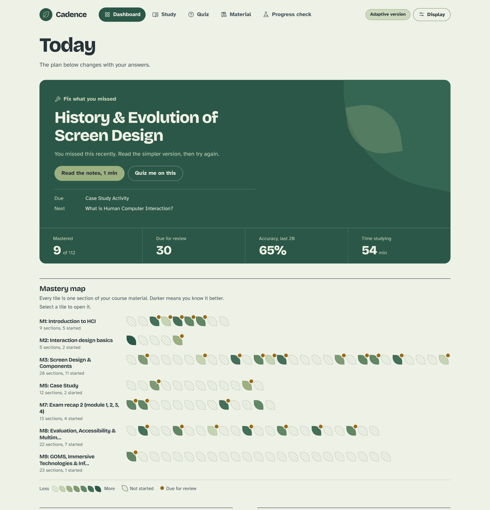
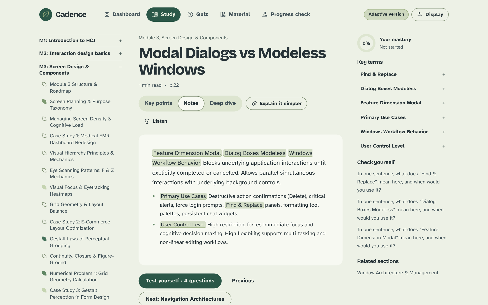
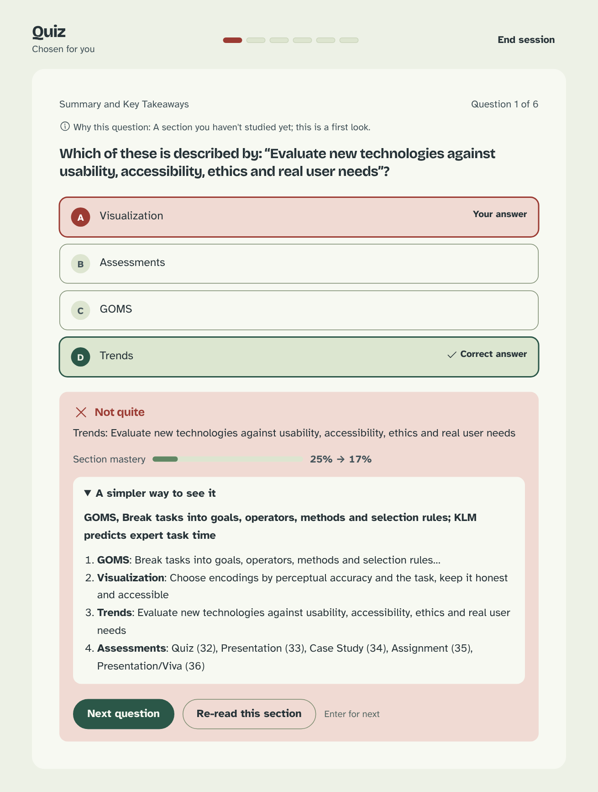

# Cadence

**An adaptive study companion built from your own course material.**
Drop in your slides and PDFs. Cadence turns them into layered notes and quizzes, works out what you actually know, and tells you what to study next.

Built for the HCI course AIM4141 at Manipal University Jaipur. It runs fully offline, on your machine, with no account and no API key.

<p align="center">
  
</p>

## What it does

- **Notes in layers.** Every section comes as key points, full notes, a deep dive with key terms and self-explanation prompts, and an "explain it simpler" version.
- **Questions from your material.** Match the label, describe it, fill the blank, numeric blanks, true or false, and recognition questions. Wrong options come from your other sections, so they sound plausible.
- **A model of what you know.** Bayesian Knowledge Tracing estimates your mastery of every section after each answer. A forgetting curve estimates when you will need a refresher.
- **A dashboard that explains itself.** A next-up plan, a leaf-shaped mastery map, a forgetting curve, accuracy trend, time per module and trouble spots. The quiz tells you why each question was chosen.
- **Your files, on the site.** Upload PDF, PPTX, TXT or MD files from the Material page. Adding a file never touches your progress.
- **A progress check.** A 12-question pre-check and post-check give your learning gain, and a 10-item System Usability Scale survey scores the tool itself. Export every answer and interaction as CSV.
- **Accessible by design.** Atkinson Hyperlegible or Lexend, text size and line spacing controls, higher contrast, reduced motion, light and dark themes, read-aloud, full keyboard quizzing, screen reader announcements and a "view as table" option for every chart.

<p align="center">
  
  
</p>

## Quick start

You need [Miniconda](https://docs.conda.io/en/latest/miniconda.html) or Anaconda.

```bash
cd cadence
./run.sh
```

The first run creates a conda environment named `cadence`, installs the dependencies and opens http://localhost:8000. Then open **Material** and add your files.

Prefer to do it by hand?

```bash
cd cadence
conda env create -f environment.yml
conda activate cadence
python -m uvicorn app.main:app --port 8000
```

## How it works

```
files ─> sections ─> layered notes ─> questions ─> your answers ─> learner model ─> dashboard and next step
```

1. **Reading.** PDFs are read page by page and slides one by one. Hard-wrapped lines are rejoined, boilerplate pages (agenda, references) are dropped and each page gets a title guess. Thin pages are merged into useful sections.
2. **Structure.** `Label: description` lines and table rows become facts, full sentences become statements, and capitalised phrases and acronyms become candidate key terms, ranked with TF-IDF.
3. **Notes.** The notes are your own text, selected and rearranged, not invented. Key points are the highest-scoring facts and statements by cosine similarity to the section. Related sections are found the same way.
4. **Questions.** About eight per section, built from facts and statements. Fragments and garbled slide text are filtered out.
5. **Learner model.**
   - *Bayesian Knowledge Tracing* starts each section at 25% and updates with every answer, allowing for slips (12%) and guesses (30% on multiple choice, 50% on true or false).
   - *Forgetting curve*: recall decays as `R = e^(-t/S)`, and a section is due for review when estimated recall drops below 70%.
   - *Next step*: priority = 0.55 x not known + 0.35 x forgotten + 0.10 x recently wrong, with question difficulty matched to mastery.
6. **Optional local AI.** If [Ollama](https://ollama.com) is running (`ollama pull qwen2.5:3b`), it can rewrite the simpler layer and add extra questions. Every generated question is checked against the source text and dropped if the text does not support it. Without Ollama, everything works with the built-in engine.

## Project structure

```
cadence/
  app/        ingest.py  nlp.py  generate.py  build.py    material to notes and questions
              tracing.py  analytics.py                    learner model and dashboard data
              llm.py  db.py  main.py  config.py           optional Ollama, SQLite, FastAPI server
  static/     landing.html  index.html  styles.css  js/   landing page and the app (no build step)
  run.sh  environment.yml  requirements.txt  titles.json
Dockerfile  render.yaml                                    deployment
```

**Stack:** Python, FastAPI, SQLite, plain JavaScript modules, bundled fonts and Phosphor icons. No build step, no external services.

## Deploying

Cadence needs a Python host (FastAPI plus SQLite), so it cannot run as a static page.

- **Render:** push this repo to GitHub, then New > Web Service > Docker (the included `render.yaml` also works as a Blueprint).
- **Hugging Face Spaces:** create a Docker Space and upload the repo. Port 7860 is already the default.
- **Anywhere with Docker:** `docker build -t cadence . && docker run -p 7860:7860 -v cadence-data:/data cadence`

Notes: the cloud version uses the built-in engine because Ollama will not be there. Uploaded files and progress live in `/data`, so attach a persistent disk or they reset when the instance restarts. There is no login: each browser gets its own private workspace through a cookie, so visitors never see each other's files or progress, but clearing site data or switching device starts a fresh, empty one.

## Honest limits

- Notes are rule-based extraction, not paraphrased text, so messy slides give messy notes. Diagram-heavy slides give thin questions.
- The learner model parameters are sensible defaults, not fitted to real learners. The forgetting curve is an estimate.
- Scanned PDFs without a text layer cannot be read (they need OCR first).
- The Ollama path has only been tested against a mock server.
- One learner per browser. A group comparison of the adaptive and control versions across people is not built into the app, and progress does not sync between devices.

## Settings

| Variable | Default | Purpose |
|---|---|---|
| `CADENCE_DATA` | `cadence/data` | where the SQLite database lives |
| `CADENCE_MATERIAL` | `material` | where uploaded files are stored |
| `OLLAMA_URL` | `http://localhost:11434` | local model server |
| `CADENCE_MODEL` | `qwen2.5:3b` | local model name |
| `PORT` | `8000` (`7860` in Docker) | server port |

## Credits

Fonts: Atkinson Hyperlegible (Braille Institute), Lexend, Bricolage Grotesque, all SIL OFL. Icons: [Phosphor Icons](https://phosphoricons.com), MIT.
